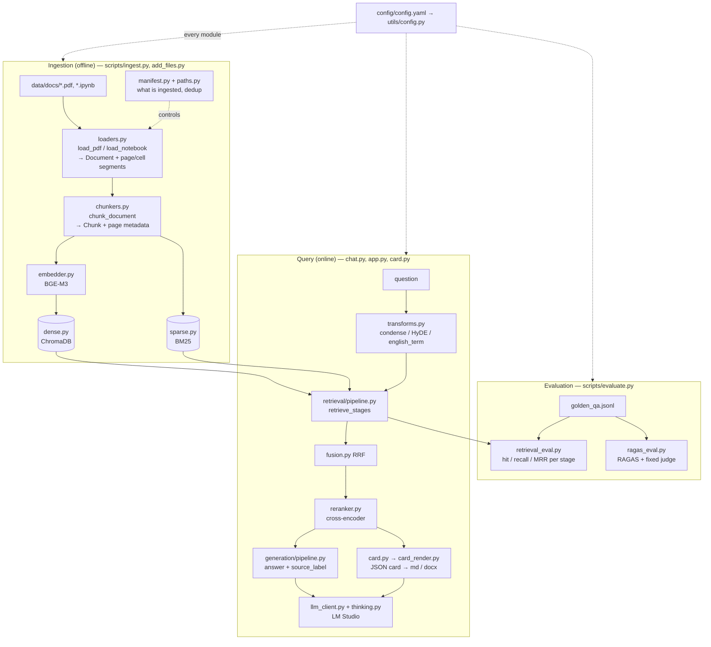
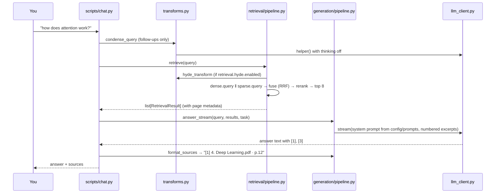

# Project Guide — what changed, how to run it, how to read it

Three parts:
1. [What was added](#1-what-was-added): every change, grouped by PR
2. [Commands](#2-commands): every script, with each flag explained
3. [Reading the code](#3-reading-the-code): a map, a reading order, and one request traced end to end

---

## 1. What was added

| PR | What | Why | Main files |
|---|---|---|---|
| [#1](https://github.com/GilRahamim/AI_Engineer_ChatBot/pull/1) | **Index dedup and cleanup** | The index held about 2× duplicate chunks: 251 files were ingested twice, once under a relative path and once under an absolute one. 3 notebooks made up 56% of chunks, mostly training logs. | `src/utils/paths.py`, `src/ingestion/manifest.py`, `src/ingestion/pipeline.py`, `src/ingestion/loaders.py`, `src/retrieval/sparse.py` |
| #1 | **Deterministic retrieval eval** | RAGAS alone can't catch a retrieval regression. It runs on 23 questions with truncated contexts, judged by the generator itself. | `src/evaluation/retrieval_eval.py`, `scripts/evaluate.py`, `scripts/label_sources.py` |
| #1 | **Unit tests** | The repo had none. A manifest test would have caught the duplicate-path bug. | `tests/` |
| [#2](https://github.com/GilRahamim/AI_Engineer_ChatBot/pull/2) | **Concept cards** (`/card`) | A fixed-structure study sheet modelled on your `Convolution.docx`, exported as Hebrew right-to-left `.docx` with native Word equations | `src/generation/card.py`, `src/generation/card_render.py`, `config/prompts/card.txt`, `scripts/card.py` |
| #2 | **Per-call retrieval overrides** | Cards run one retrieval per section, can filter by `file_type`, and skip HyDE | `src/retrieval/pipeline.py`, `dense.py`, `reranker.py` |
| [#3](https://github.com/GilRahamim/AI_Engineer_ChatBot/pull/3) | **Model-agnostic generation layer** | The code assumed GPT-OSS (`reasoning_effort` was hardcoded). With Qwen, helper calls could spend their whole budget thinking and silently return nothing. | `src/generation/llm_client.py`, `src/generation/thinking.py`, `src/retrieval/transforms.py` |
| #3 | **Fixed RAGAS judge, CPU option for embedder and reranker** | Switching the generator also switched the judge, so scores weren't comparable. The CPU option frees about 2 GB of VRAM for a larger LLM. | `src/evaluation/ragas_eval.py`, `src/embedding/embedder.py`, `src/retrieval/reranker.py` |
| #3 | **Page and cell metadata** | Citations could only say "chunk 17". Now they say `file.pdf · pp.3–4` or `nb.ipynb · cells 12–14`. | `src/ingestion/loaders.py`, `src/ingestion/chunkers.py`, `src/generation/pipeline.py` |

### Key ideas in one line each
- **Canonical source key:** every file is identified by a root-relative POSIX path such as `data/docs/Topic 1/a.pdf`. Old keys in Windows or absolute format are converted when the manifest loads (`normalize_key`).
- **Chunks are never modified (hard rule 1).** A file that changed is skipped with a warning, an identical copy under another name is recorded as `duplicate_of`, and changes to the loader or chunker require `--rebuild`.
- **Eval per stage:** each metric is reported for `dense`, `sparse`, `fused` and `final`, so a regression can be traced to the stage that dropped the relevant chunk.
- **Grounding in code:** card items without a valid `[n]` citation are deleted after generation, not just discouraged in the prompt.
- **One LLM gateway:** every call goes through `LLMClient._request`, so thinking style, sampling and `<think>` stripping are set once in config.

Fusion and the main ranking metric, for reference:

$$\text{RRF}(d) = \sum_{r \in \{\text{dense},\,\text{sparse}\}} \frac{1}{k + \text{rank}_r(d)}, \quad k = 60
\qquad\qquad
\text{MRR} = \frac{1}{|Q|}\sum_{q \in Q} \frac{1}{\text{rank}_q}$$

---

## 2. Commands

> Run everything from the repo root. LM Studio must be running for anything that calls the LLM (chat, cards, eval, HyDE).

### Setup and tests

| Command | What it does | Flags |
|---|---|---|
| `pip install -e ".[dev]"` | Installs the project and its dependencies | `-e`: editable install, so `src/` is imported from your working copy and code changes apply without reinstalling. `.[dev]`: also installs the `dev` extras (pytest). |
| `pytest` | Runs all unit tests (no GPU, LLM or index needed) | none |
| `pytest -q tests/test_card.py -k docx` | Runs a subset | `-q`: quiet output. A file path runs only that file. `-k docx`: only tests whose name contains "docx". |

### Ingestion

| Command | What it does | Flags |
|---|---|---|
| `python scripts/ingest.py` | Ingests all files under `data/docs/`. Unchanged files are skipped. | none |
| `python scripts/ingest.py --rebuild` | **Deletes** the Chroma collection, the BM25 index and the manifest, then re-ingests everything | `--rebuild`: needed after any loader, chunker or embedder change, or when the manifest warns about duplicate paths |
| `python scripts/ingest.py --docs D:/other/folder` | Ingests from a different folder | `--docs PATH`: replaces `paths.docs` from config for this run |
| `python scripts/add_files.py` | Incremental: adds only new files | `--docs PATH`: same as above |
| `python scripts/add_files.py "data/docs/x.pdf" "data/docs/y.ipynb"` | Adds only the listed files | Positional `paths`: the files to process. Without them, the whole docs folder is scanned. |

### Evaluation

| Command | What it does | Flags |
|---|---|---|
| `python scripts/label_sources.py` | Walks through unlabelled golden questions, shows candidate files, and saves your picks to `expected_sources` | `--golden PATH`: question file (default `evaluation.golden_qa`). `--questions q001,q013`: only these IDs. `--relabel`: also revisit questions that already have labels. |
| `python scripts/evaluate.py --retrieval-only --output data/eval/results/base_ret.json` | Retrieval metrics only, with no generation and no judge. Takes seconds per question. | `--retrieval-only`: skips the LLM answer and RAGAS. `--output PATH` (**required**): where to save the results JSON. |
| `python scripts/evaluate.py --output data/eval/results/base.json` | Full run: retrieval metrics plus RAGAS (faithfulness, answer relevancy, context precision and recall) | `--output PATH`: as above |
| `python scripts/evaluate.py --output new.json --compare base.json` | Runs, then prints the difference from an earlier run with a verdict per metric | `--compare PATH`: earlier results file. Warns if the question set, labels, generator or judge differ between runs. |
| `python scripts/evaluate.py --output q.json --questions q001,q013` | Evaluates only some questions | `--questions IDS`: comma-separated IDs. `--golden PATH`: another question file. |

### Using the assistant

| Command | What it does | Flags and in-app commands |
|---|---|---|
| `python scripts/chat.py` | Terminal chat over the course material, with citations | `--task {default,concept,summary,interview}`: prompt profile, matching a file in `config/prompts/`. `--topic "Transformers"`: prepended to every retrieval query. **Inside the chat:** `/card <concept>` builds a card, and `quit` exits. |
| `chainlit run app.py -w` | Browser UI at `http://localhost:8000` | `-w`: watch mode, reloads when code changes. **Inside the UI:** `/task <name>` switches profile (`default`, `concept`, `interview`, `summary`, `glossary`), `/<task> question` asks once in a given profile, `/card <concept>` builds a card with a `.docx` download. |
| `python scripts/card.py "Convolution"` | Builds a concept card and writes `summaries/cards/Convolution.{md,json,docx}` | Positional `concept`: in English or Hebrew (Hebrew is translated to the English term for retrieval). `--language hebrew\|english`: prose language (default `card.language`). `--output-dir DIR`: default `paths.cards`. `--no-docx`: skip the Word export. |

### Study tools (existing scripts)

| Command | What it does | Flags |
|---|---|---|
| `python scripts/interview.py` | Interview simulator with spaced repetition | `--topic "NLP"`: filter by topic. `--difficulty easy\|medium\|hard`. `--n 5`: number of questions (default `interview.default_n`). `--mode adaptive\|random`: adaptive puts weak or overdue topics first. `--questions PATH`: question file. |
| `python scripts/flashcards.py` | Builds a flashcard deck from weak interview answers | `--topic`: filter by topic. `--threshold 3`: highest score to include (default `interview.review_threshold`). `--output-dir DIR`. |
| `python scripts/progress.py` | Prints a study-progress summary | none |
| `python scripts/generate_pdf.py "Transformers"` | Topic summary as a PDF | `--output-dir DIR`. ⚠️ It uses latin-1 Helvetica, so Hebrew text and formulas are lost. Prefer `card.py`. |

### Recommended order on your machine now

```bash
pip install -e ".[dev]" && pytest                         # 1. install and check
# 2. In config.yaml for Qwen: set evaluation.judge_model, generation.thinking.style,
#    sampling values from the model card, and a larger max_tokens.
#    Keep these fixed while comparing.
python scripts/label_sources.py                           # 3. label the golden questions
python scripts/evaluate.py --retrieval-only --output data/eval/results/before.json  # 4. baseline
python scripts/ingest.py --rebuild                        # 5. dedup + notebook cap + pages in one rebuild
python scripts/evaluate.py --retrieval-only --output data/eval/results/after.json \
    --compare data/eval/results/before.json               # 6. compare
python scripts/card.py "Convolution"                      # 7. try a real card
```
If you haven't rebuilt since PR #1, this single rebuild applies everything. Expect `dup_rate` to fall to about 0 and the metrics to change, mostly from the dedup. Page metadata alone doesn't change chunk text.

---

## 3. Reading the code

### 3.1 The map



### 3.2 Reading order

Read top to bottom. Each step uses only what came before it.

| # | File | Start at | What to look for |
|---|---|---|---|
| 1 | `config/config.yaml` | the whole file | Every tunable lives here (hard rule 2). Skim the sections: `ingestion`, `retrieval`, `generation`, `evaluation`, `card`. |
| 2 | `src/utils/config.py` | `Config` (line 162), `load_config` (196) | Pydantic models mirror the YAML one to one. Every module calls `get_config()`. |
| 3 | `src/utils/paths.py` | `source_key` (24) | Why `data\docs\a.pdf` and `C:\...\data\docs\a.pdf` become one key. Root of the dedup fix. |
| 4 | `src/ingestion/loaders.py` | `Document` (51), `_join` (62), `load_pdf` (93), `load_notebook` (144) | How a file becomes one text plus `segments`, the start offsets of pages or cells. Also `_truncate_output` (126): the training-log cap. |
| 5 | `src/ingestion/chunkers.py` | `chunk_document` (33), `_span` (25) | Splitting on markdown headings, and mapping a chunk's offset back to `page`/`page_end`. |
| 6 | `src/ingestion/manifest.py` | `Manifest.status` (35), `load_manifest` (74) | `new` / `unchanged` / `changed`, the `duplicate_of` records, and the legacy-key migration warning. |
| 7 | `src/ingestion/pipeline.py` | `ingest_files` (18) | **The ingestion loop.** It ties 3–6 together, plus the embedder and both stores. Note the per-file manifest save and the single BM25 build in `finally`. |
| 8 | `src/retrieval/dense.py` → `sparse.py` | `DenseRetriever.query` (54), `SparseRetriever.add/build` (77, 95) | `RetrievalResult`, the object passed everywhere after this point. BM25 indexing is deferred. |
| 9 | `src/retrieval/fusion.py` → `reranker.py` | `reciprocal_rank_fusion` (9), `rerank` (26) | RRF in about 15 lines, then the cross-encoder top-n |
| 10 | `src/retrieval/pipeline.py` | `retrieve_stages` (31) | **The query-side retrieval in one function:** HyDE → dense + sparse → fuse → rerank. Returns every stage for eval. |
| 11 | `src/generation/thinking.py` → `llm_client.py` | `LLMClient._request` (34), `helper` (80) | One place builds every request: thinking style, sampling, `<think>` stripping |
| 12 | `src/retrieval/transforms.py` | `condense_query` (64), `hyde_transform` (86) | The short helper LLM calls, with thinking off and small budgets |
| 13 | `src/generation/pipeline.py` | `answer` (44), `source_label` (78), `format_sources` (91) | Prompt assembly from `config/prompts/*.txt`, and turning `[n]` into `file.pdf · p.3` |
| 14 | `scripts/chat.py` | `main` | Now read an entry point. Everything it calls is familiar from 1–13. |
| 15 | `src/generation/card.py` | `make_card` (210), then `gather_context` (104), `ground` (163) | Cards: per-section retrieval → JSON schema → grounding. `config/prompts/card.txt` is the prompt. |
| 16 | `src/generation/card_render.py` | `to_markdown` (109), `write_docx` (265) | The same card as markdown and as an RTL `.docx` (pandoc, then python-docx fixes) |
| 17 | `src/evaluation/retrieval_eval.py` | `run_retrieval_eval` (156), `score_ranking` (95), `SourceMatcher` (69) | Hit@k, recall@k, MRR, `dup_rate`, and label matching through content hashes |
| 18 | `scripts/evaluate.py` | `main`, `print_comparison` | How runs are saved and compared |
| 19 | `tests/` | any `test_*.py` | Each test is a small, runnable example of one behaviour. `test_pages.py` and `test_card.py` are good starting points. |

**Shortcut:** to understand only "question → answer", read steps **1, 2, 10, 11, 13, 14** (about 300 lines).

### 3.3 One chat question, traced



### 3.4 Which config section affects what

| `config.yaml` section | Read by | Changing it requires |
|---|---|---|
| `paths` | everything | none |
| `ingestion` (chunk size, notebook caps) | `loaders.py`, `chunkers.py` | **`ingest.py --rebuild`** + eval before and after |
| `embedding` | `embedder.py` | a model change requires **`--rebuild`**; `device` changes don't |
| `retrieval` (top-k, fusion, reranker, HyDE) | `retrieval/*.py` | eval before and after (rule 3) |
| `generation` (model, thinking, sampling, tokens) | `llm_client.py`, `transforms.py` | a fresh baseline when the model changes (HyDE uses it) |
| `evaluation` (judge, ks, labelling) | `retrieval_eval.py`, `ragas_eval.py`, `label_sources.py` | none, but keep `judge_model` fixed |
| `card` | `card.py`, `card_render.py` | none |
| `interview`, `chat` | `interview.py`, `flashcards.py`, `chat.py` | none |

---

## 4. Known gaps and next steps

- **Not yet run against your real index or LM Studio.** Everything is covered by unit tests (60 passing), but the steps in [Recommended order on your machine now](#recommended-order-on-your-machine-now) are still open.
- **Qwen settings:** `thinking.style` is still the GPT-OSS default. Pick `chat_template_kwargs` or `soft_switch` and check that HyDE and condensing return text (see "Switching the LLM" in `CLAUDE.md`).
- **Chainlit doesn't stream.** The README says "streamed answers", but `app.py` calls `answer()` and waits for the full text. `chat.py` uses `answer_stream`.
- **`chat.py --task` doesn't offer `glossary`.** The prompt exists and Chainlit supports it.
- **The golden set has no Hebrew questions.** BM25 can't match Hebrew queries against English material, so this blind spot isn't measured yet.
- **Planned next:** contextual chunk headers (changes chunk text, so it needs its own eval cycle), and using the course slide as the card's figure (now possible with page metadata).
